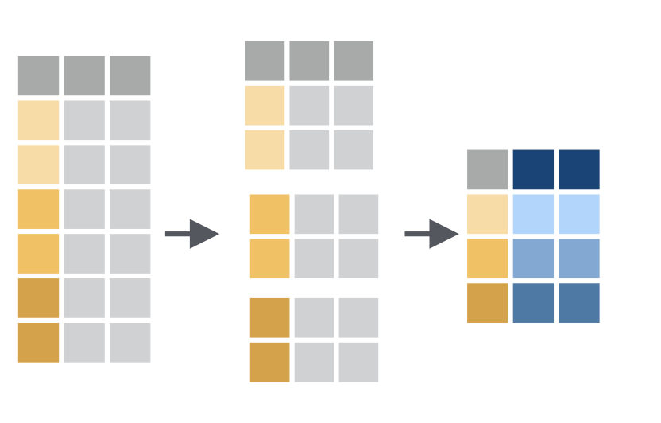

```{r, echo=FALSE}
knitr::opts_chunk$set(
  comment = "#>",
  collapse = TRUE,
  # cache = TRUE,
  fig.retina = 2,
  fig.width = 6,
  fig.asp = 2 / 3,
  fig.show = "hold"
)
```

## Aufgabe 1

Die Studiendaten und Ihre Daten Laden Sie die Daten aus der Datei „Studie_KaffeeKonzentration_2025.csv“ in R als Objekt „Kaffee“ .

```{r}
library(tidyverse)

path <- "Studie_KaffeeKonzentration_2025.csv"

kaffee <- read_csv2(path)

# same as 
kaffee <- read_delim(path, 
                     delim  = ";", 
                     locale = locale(decimal_mark = ","))

help(read_delim)
# for read_*() family of functions
```

I don't want to conform to klein/groß schreibung.

```{r}
names(kaffee)

kaffee <- 
  kaffee |> 
  janitor::clean_names()

kaffee
```

Fügen Sie für sich selbst eine Zeile als zusätzliche Versuchsperson hinzu.

```{r}
kaffee <- 
  kaffee |> 
  add_row(nummer                   = 126,
          kaffeekonsum             = 4.5, 
          gruppe                   = "entkoffeiniert",
          konzentrationsfaehigkeit = 21.35)
```

## Aufgabe 2 – Kenngrößen

Berechnen Sie Mittelwert, Median und Standardabweichung für die Variable „Kaffeekonsum“ über die gesamte Stichprobe.

```{r}
# als tabelle 
kaffee |> 
  summarise(mean   = mean(kaffeekonsum),
            median = median(kaffeekonsum),
            sd     = sd(kaffeekonsum))
```

Berechnen Sie Mittelwerte, Mediane und Standardabweichungen für die Variable „Konzentrationsfähigkeit“ getrennt nach den beiden Gruppen.

```{r}
kaffee |> 
  group_by(gruppe) |> 
  summarise(mean   = mean(kaffeekonsum),
            median = median(kaffeekonsum),
            sd     = sd(kaffeekonsum))
```

`group_by()` splits the table into smaller tables for each group in the backround. `summarise()` is performed on each sub-table. Like this:

{width="235"}

## Aufgabe 3 – Visualisierung

Stellen Sie die Daten für die Variable „Kaffeekonsum“ über die gesamte Stichprobe in einem Histogramm mit geeigneter Klassenzahl (Ermittlung über Faustformel aus der Vorlesung) dar.

Stellen Sie die Daten für die Variable „Konzentrationsfähigkeit“ getrennt nach den beiden Gruppen in Histogrammen mit geeigneter Klassenzahl (Ermittlung über Faustformel aus der Vorlesung) dar. Die beiden Histogramme sollen nebeneinander in einer Zeile angeordnet sein.

```{r}
# bins bestimmen
n <- nrow(kaffee)
bin <- round(1 + log2(n))

hh <- 
  ggplot(kaffee, aes(x = kaffeekonsum)) +
  geom_histogram(bins = bin) +
  labs(
    title = "Histogramm des Kaffeekonsums",
    x = "Kaffeekonsum",
    y = "Häufigkeit"
  ) +
  theme_minimal()

hh
```

How does `ggplot` synthax work ? Think of each line of as a transparenzfolie. Each folie contains just a single portion of the plot.

Lets run the code step by step.

```{r}
# creates an empty plot space
# 
a <- ggplot(kaffee, aes(x = konzentrationsfaehigkeit))
a
```

```{r}
a + 
  geom_histogram()
```

```{r}
a + 
  geom_line(aes(y = kaffeekonsum))
```

```{r}

```
