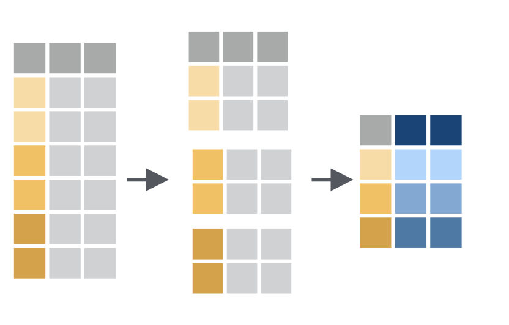

```{r, echo=FALSE}
knitr::opts_chunk$set(
  comment = "#>",
  collapse = TRUE,
  # cache = TRUE,
  fig.retina = 2,
  fig.width = 6,
  fig.asp = 2 / 3,
  fig.show = "hold"
)
```

Eleonore arbeitet weiterhin als studentische Hilfskraft in dem Projekt zu Depression unter jungen Menschen an der Kinder- und Jugendpsychatrie. Sie hatte schon den Datensatz studie_4_depression.csv zur Analyse vorbereitet. Nun wurde diese Studie repliziert und Eleonore soll diese Daten nun auch zur Analyse vorbereiten und erste Analysen durchführen. Eleonore importiert die Daten, führt die gleichen Vorverarbeitungsschritte durch (d.h., z-Transformation anhand der Mittelwerte und Standardabweichungen der jeweiligen Erhebungsinstrumente), und schaut sich die Verteilungen der Daten an.

```{r}
library(tidyverse)
df <- read_csv2("Daten_Uebung_6.csv")
```

In der ersten Analysen soll Eleonore testen, ob sich die Mittelwerte der jeweiligen untersuchten Populationen vom entsprechenden Skalenmittelwert unterscheiden. Dafür kann sie direkt die z-transformierten Werte verwenden, denn durch die z-Transformation ist der entsprechende Skalenmittelwert in allen drei Altersgruppen mu = 0 und die einzelnen Werte zeigen direkt die standardisierte Abweichung von diesem Mittelwert. Damit schätzt der jeweilige Mittelwert der z-transformierten Werte direkt die mittlere Abweichung der untersuchten Populationen vom entsprechenden Skalenmittelwert.

```{r, eval=FALSE}
df |> 
  group_by(questionnaire) |> 
  summarise(
    m  = mean(index_z),
    se = sd(index)/sqrt(n())
  )
```

{width="235"}

```{r, eval=FALSE}
t.test(
  Dresden %>%
    pull(Zufriedenheit_eigene_Seite),
  mu = 18,
  alternative = ”two.sided”)
```

```{r}
df <- 
  janitor::clean_names(df)

eigene_seite <- 
  df |> 
  pull(zufriedenheit_eigene_seite)

eigene_seite

t.test(eigene_seite,
       mu = 18,
       alternative = "two.sided")

```
