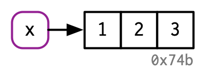
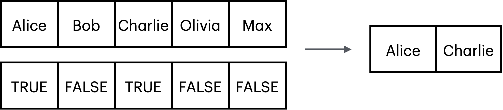

```{r, echo=FALSE}
knitr::opts_chunk$set(
  comment = "#>",
  collapse = TRUE,
  # cache = TRUE,
  fig.retina = 2,
  fig.width = 6,
  fig.asp = 2 / 3,
  fig.show = "hold"
)
```

## 🧱 What Are Vectors

In R, a vector is the most basic and essential data structure. It’s simply a sequence of elements—like a list of numbers, characters, or logical values—**all of the same type**.

You can think of a vector like a row of boxes, where each box holds one value—and **all boxes must hold the same kind of thing**.

```{r}
#| echo: true
#| results: 'markup'
#| collapse: true
#| comment: "#>"
x <- 1:3
x
```

{width="249"}

## 🆎 Types of Vectors

There are many data types. You can use function `class()` to see the type. Here are the main ones:

| **Data Type** | **Code Example**             | **Description**                                                                                                                                         |
|:------------------|:------------------|:---------------------------------|
| Numeric       | `x <- 3.14`                  | A real (floating point) number. Used for quantities with fractions like weight, height, gpa score. Pretty much most common.                             |
| Integer       | `x <- 5L`                    | Similar to Numeric but used for discrete counts . Number of people, apples, floors in a building.                                                       |
| Character     | `x <- "hello"`               | A text (string) value. Names, comment                                                                                                                   |
| Logical       | `x <- TRUE`                  | Also called Boolean value: `TRUE` or `FALSE` . Used when there are only two states for something, yin/yan, dead/alive, pass/fail, on/off, keep/discard. |
| Date          | `x <- as.Date("2020-02-01")` | date format. you can do math operations like this then `as.Date("2020-01-02") - as.Date("2020-01-01")`                                                  |

## 📦 Example

Lets create some vectors of different types and then combine them together into a `data.frame` .

### 🔤 Character vector:

```{r}
name <- c("Alice", "Bob", "Charlie", "Olivia", "Max")
gender <- c("female", "male", "diverse", "female", "male")
class(name)
```

### 📊 Numeric vector:

```{r}
height <- c(1.71, 1.82, 1.78, 1.68, 1.95)
weight <- c(56, 80, 75, 54, 95)

class(height)
```

### ✅ Logical vector:

```{r}
is_married <- c(TRUE, FALSE, TRUE, FALSE, FALSE)
class(is_married)

# kleiner exkurs
# why logical vectors are useful
# the square brackets '[' are used to select elements of a vector
name[1]
name[3]
# vorsicht
name[99]

# instead of numbers we can pass a logical vector with the same length
# which will keep elements TRUE
name[is_married]
```

{width="441"}

### 📅 Date vector:

```{r}
# i will generate 5 random birthdays 

# all are born in the year 2000
beginning <- as.Date("2000-01-01")
end       <- as.Date("2000-12-31")

class(beginning)

# arithmetics is possible
end - beginning


# generate all dates in 2000
# and pick 5 at random
# (i am using the new pipe symbol '|>')
birthday <- 
  seq(from = beginning, to = end, by = 1) |>  
  sample(5)

birthday

# same thing without piping
  # option 1. with an intermediate object for all 2000 dates
x <- seq(beginning, end, by = 1)
birthday <- sample(x, 5)

length(x)
head(x)
tail(x)

  # option 2. nested, e.g. without intermediate x
birthday <- sample(seq(beginning, end, by = 1), 5)
```

## 🧮 Data Frame

Data frame is table. Each column of the table is a vectors.

```{r}
people <- 
  data.frame(name, birthday, height, weight, gender, is_married)

people

class(people)

# now we can do some data analysis using
library(tidyverse)

# like finding out who
people |> 
  filter(is_married)

# or who is
people |> 
  filter(gender == "male",
         height > 1.90)

# more next time :)
```
